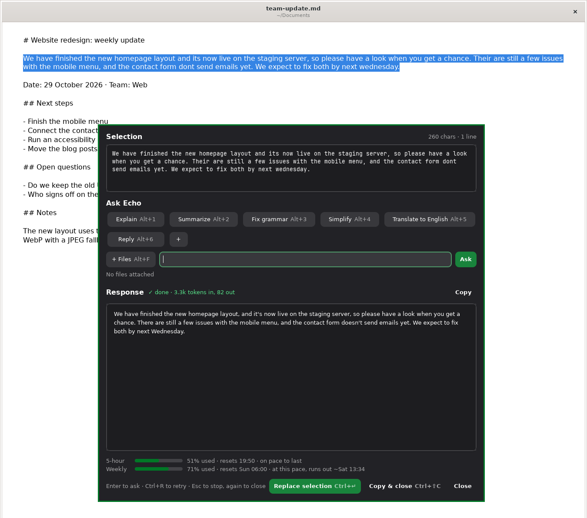

# echo-ai

Ask Claude about whatever text you have highlighted, from any app, with one key.



Highlight text anywhere on your X11 desktop, press your shortcut (e.g. **Super+I**), and a small
popup opens with the selection. Explain it, summarize it, fix its grammar, translate it, draft a
reply, or ask your own question. Then copy the answer or paste it straight back over the
selection. With nothing highlighted, the popup works as a quick general-purpose assistant.

echo-ai doesn't talk to Anthropic itself. It runs your own, unmodified
[Claude Code](https://code.claude.com) CLI (`claude -p`), so it uses whatever account you've signed
Claude Code into.

## Features

- **Works in any app.** It reads the highlighted text (the X11 PRIMARY selection, or a Ctrl+C for
  apps such as OnlyOffice that don't set PRIMARY) and puts your clipboard back afterwards.
- **One-click presets:** Explain, Summarize, Fix grammar, Simplify, Translate to English, Reply,
  plus **your own actions**, added with **+** and removed with their ✕.
- **Replace selection** pastes the answer back over the original text in the source app. With
  nothing highlighted, **Paste** inserts it at the cursor instead.
- **Streaming Markdown replies** with syntax-highlighted code blocks, each with a Copy button.
- **Files and images as context:** attach files, or let it pick up an image already on the
  clipboard.
- **Plan usage at a glance:** your 5-hour and weekly Claude limits, with a pace estimate.
- **Keyboard-driven,** see [Hotkeys](#hotkeys).
- **Follows your GTK theme,** light or dark.

## Requirements

- Linux with an **X11** session (Wayland isn't supported)
- Python 3, GTK 3, WebKitGTK 4.1, PyGObject
- `xclip`, `xprop`, and the libX11, libXfixes and libXtst libraries
- [Claude Code](https://code.claude.com/docs/en/setup), installed and signed in (run `claude` once
  in a terminal)

`install.sh` installs the system packages itself on Arch Linux (pacman). On other distributions,
install the equivalents of `python python-gobject gtk3 webkit2gtk-4.1 xclip xorg-xprop libx11
libxfixes libxtst` first.

## Install

```bash
git clone https://github.com/davidnsousa/echo-ai.git
cd echo-ai
./install.sh
```

This installs echo-ai to `/opt/echo-ai` (with its own Python venv), adds an `echo-ai` command in
`/usr/local/bin` and an app-menu entry. It asks for sudo. Run `./install.sh` again to update.

Two steps are left to you:

1. **Bind a key** to `echo-ai --show` in your window manager or desktop's keyboard settings
   (e.g. Super+I).
2. **Optional:** start it at login by adding `echo-ai --start &` to `~/.xinitrc` or your
   desktop's autostart. Without this, the first `echo-ai --show` starts it.

To remove it:

```bash
echo-ai --uninstall
```

## Usage

| Command | What it does |
|---|---|
| `echo-ai --show` | Open the popup for the current selection (starts the background process if needed) |
| `echo-ai --start` | Start the background process without opening the popup |
| `echo-ai --stop` | Stop the background process |
| `echo-ai` | Run in the foreground, with output in the terminal |
| `echo-ai --uninstall`, `-R` | Remove echo-ai |

The background process keeps track of selection changes. `--show` asks it, over a Unix socket, to
read the selection and open the popup.

### Hotkeys

Inside the popup:

| Key | Action |
|---|---|
| **Enter** | Ask the question typed in the box |
| **Alt+1 … Alt+9** | Run a preset or one of your actions, in the order shown (when text is selected) |
| **Alt+F** | Attach files |
| **Ctrl+Enter** | Replace selection with the answer (or paste it at the cursor) |
| **Ctrl+Shift+C** | Copy the answer (or the selection) and close |
| **Ctrl+R** | Run the last question again |
| **Esc** | Stop a reply that's still coming in; press again to close |

### Customizing

**Your own actions:** click **+** after the presets, give the action a name and the instruction
to send with the selected text (e.g. "Rewrite this in a formal tone."), and it appears as a new
chip with the next Alt+number. Its ✕ removes it. They're saved in
`~/.config/echo-ai/presets.json`, so updates and uninstalls keep them.

The built-in presets, the assistant's name and the code-highlighting style are constants at the top of
`echo-ai.py` (`PRESETS`, `ASSISTANT_NAME`, `CODE_STYLE`). Edit them and run `./install.sh` again.

Set `ECHO_AI_DEBUG=1` to print debug output about selection handling.

## Privacy

- Text you **send** (the selection, your question and any attached files) goes to Anthropic
  through Claude Code, under your own Claude account and
  [Anthropic's terms](https://code.claude.com/docs/en/legal-and-compliance). Nothing is sent
  until you click a preset or ask a question.
- Claude runs with **no tools**, except Read, limited to the folders of files you attach
  yourself. Sessions are not saved (`--no-session-persistence`).
- Locally, the log at `~/.local/state/echo-ai/echo-ai.log` records only when the popup opened
  and how many characters were selected, never the text itself. (Running `echo-ai` in the
  foreground prints the selection to that terminal.) Clipboard images and the plan-usage cache
  are kept in `/tmp/echo-ai-<uid>/`.

## Disclaimer

echo-ai is an independent, unofficial project. It is not made, endorsed or supported by
Anthropic. "Claude" and "Claude Code" are trademarks of Anthropic, PBC, and are used here only to
describe what echo-ai works with.

Your use of Claude through echo-ai is governed by your own agreement with Anthropic. echo-ai never
handles your Claude credentials: sign-in happens in Claude Code's own flow. Plan limits assume
ordinary, individual use.

## License

[MIT](LICENSE)
